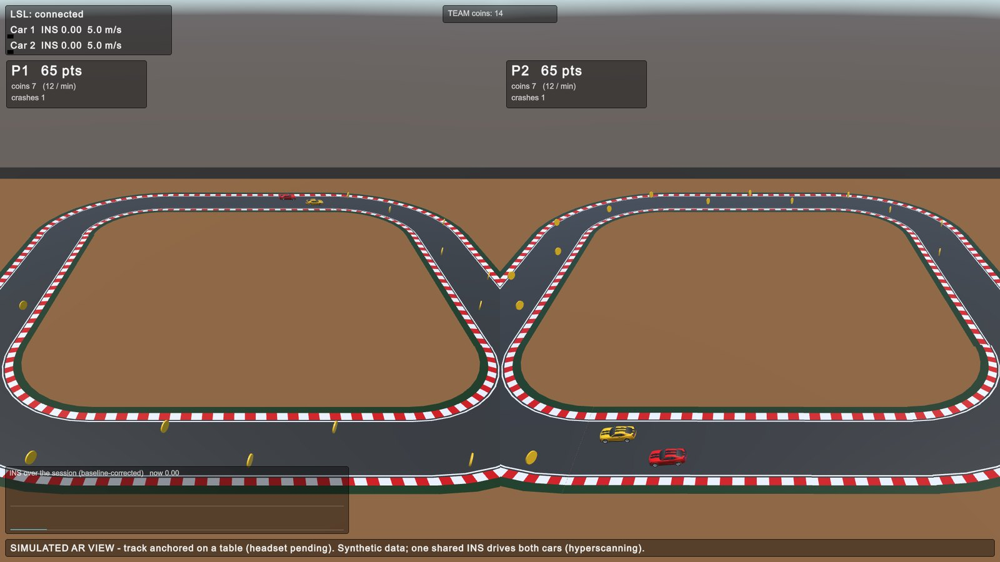
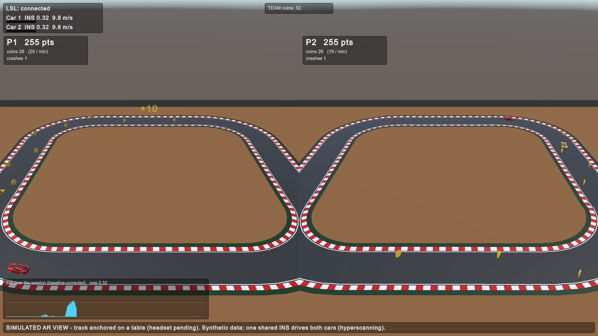
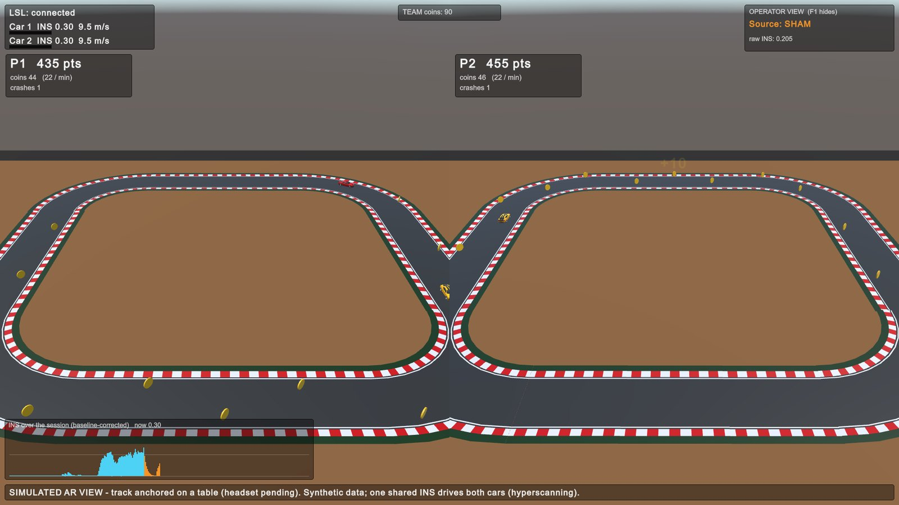
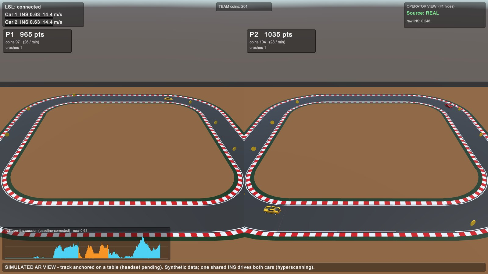
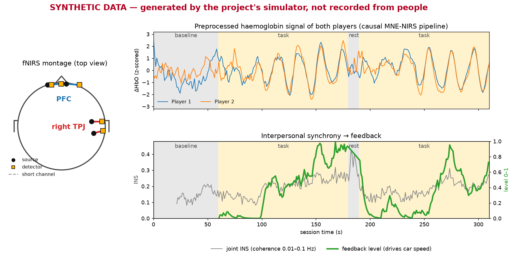
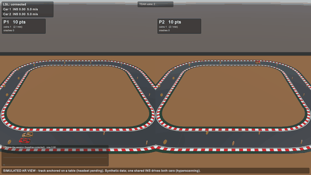

# mindX demo runbook

- 15 minutes. One live session of 5 min 10 s.
- Two players. One joint brain-synchrony signal. A car race on a table.
- Every signal is **synthetic**. The code is the real pipeline.

## What is real, what is not

- Brain signals: synthetic. A shared 0.05 Hz component is injected.
- Processing: real MNE-NIRS online code.
- Synchrony (INS): real code, synthetic input.
- Feedback: real. Speed = 5 + 15 x level, in m/s.
- Game, coins, scores: real code.
- AR table: simulated. No headset, no passthrough.

## The one thing to remember

- Both cars get the same speed signal.
- That is by design: one joint value drives the shared race.
- Cars differ in lane, line and score.
- Speed per player needs Individual mode. That decision (O7) is still open.

## Before you start

- Open Unity 6000.5.1f1 on `C:\Users\sukha\MindX-unity6\unity`.
- Branch: `unity6-mcp`.
- Open `Assets/Scenes/TableARPreview.unity`.
- Set the Game view to 16:9, for example 1920x1080.
- Keep the backend terminal in a second window.
- Warnings from the XR template scripts are expected.

## Start the backend first

- Unity looks for the LSL stream at Play.
- Without it the game freezes for about 10 seconds.

```
cd C:\Users\sukha\MindX-unity6\backend
C:\Users\sukha\MindX\backend\.venv\Scripts\python.exe -m mindx_hnf.scripts.simulate --lsl --full --toggle --montage configs\montage_demo.yaml
```

- Wait for `Operator console: press Enter ...`.
- Then press Play in Unity.
- Unity joins 10 to 25 seconds after the backend.

## Operator controls

- Backend terminal, Enter: switch the source REAL or SHAM.
- The audience sees no change on screen.
- Unity, F1: show or hide the operator overlay.
- The overlay shows the source, the raw INS and sham stretches in orange.

## Run order (session clock)

- 0:00 to 1:00, baseline.
  - Level stays 0.
  - Speed 5 m/s.
  - About 11 coins per minute.
- 1:00 to 3:00, task 1.
  - First speed-up about 30 s in.
  - Level reaches 0.7 to 1.0 near 2:30.
  - Coins per minute more than double.
- 2:30 to 3:30, sham window.
  - Press Enter at 2:30.
  - Press Enter again at 3:30.
- 3:00 to 3:10, rest.
  - Level falls. The window lags.
- 3:10 to 5:10, task 2.
  - Synchrony rises again.
  - Second peak near 4:30 to 5:00.
- fNIRS is slow: 5 to 7 s lag, 22 s window. Say it early.

## Talk track

- 0:00 to 2:00, the idea. Slide: data flow.
  - Two people, one signal, fed back as speed.
- 2:00 to 3:00, setup.
  - Backend left, game right.
  - Everything is synthetic.
- 3:00 to 8:10, live session.
  - One sentence per block.
  - Point at speed, then coins per minute, then TEAM total.
- 5:30 to 6:30, sham. Press F1.
  - Feedback replays another dyad's recording.
  - Same mapping. Players cannot tell.
- 8:10 to 10:00, the brain figure.
  - Montage on the left.
  - Both signals fall into step during tasks.
- 10:00 to 12:00, two views.
  - Each player has a view and a score.
  - Same signal, different lines.
- 12:00 to 14:00, AR on the table.
  - Game runs at full size. Table shows a scaled copy.
  - Simulated for now.
- 14:00 to 15:00, wrap-up.
  - Live fNIRS, signal quality, Individual mode, multiplayer, headset.

## What the audience sees

Baseline. Level 0. Each player has a view and a score.



Task block. Speed and coins follow the curve.



Operator view in the sham window. Participants never see this.



Second task block. Scores differ slightly. One crash each.



The brain figure. Synthetic data.



Time-lapse of a full session. Use it as the fallback.



## Say this

- The data is synthetic. The pipeline is real.
- Faster driving passes more coins.
- Sham replays another dyad's real trajectory.
- The table view simulates the AR layout.

## Do not say this

- That the players' brains drove it.
- That sham gives lower values. It also rises.
- That each player has their own speed.
- That this is passthrough AR.

## Questions

- Same speed for both cars? One joint value drives the race. Per-player speed is Individual mode.
- Why different scores? Own lane each. Inside lane is about 9% shorter. Crashes cost 5 points.
- What is sham for? It controls for reward and training effects. Only the source changes.
- How long until the car reacts? About 30 s.
- Is the AR real? No. Simulated table view.
- Real people? Not yet. Needs the NIRSport2 input.

## If it breaks

- Freeze at Play: start the backend first.
- "waiting for stream": restart the backend, then Play again.
- Speed never changes: still in baseline. Wait for 1:30.
- Enter does nothing: click the backend window first.
- Washed-out views: rebuild with MindX, Build Table AR Preview.
- Anything else: play the time-lapse and talk over it.

## What is built

- Cars stay on track: done. 0 wall contacts in 2 minutes.
- Coins and points: done. +10 per coin.
- Crash penalty: done. -5 for both cars.
- Coins depend on the signal: done. About 11 per minute at 5 m/s, 26 to 28 at 14 m/s.
- Cars move differently: partly. Lanes, lines, scores. Same speed.
- Brain figure: done. Labelled synthetic.
- AR table, two views: simulated.
- Screen recording: done as a GIF. MP4 needs ffmpeg.
- Per-player speed: decision needed (O7).
- XR rig on XRI 3: open.
